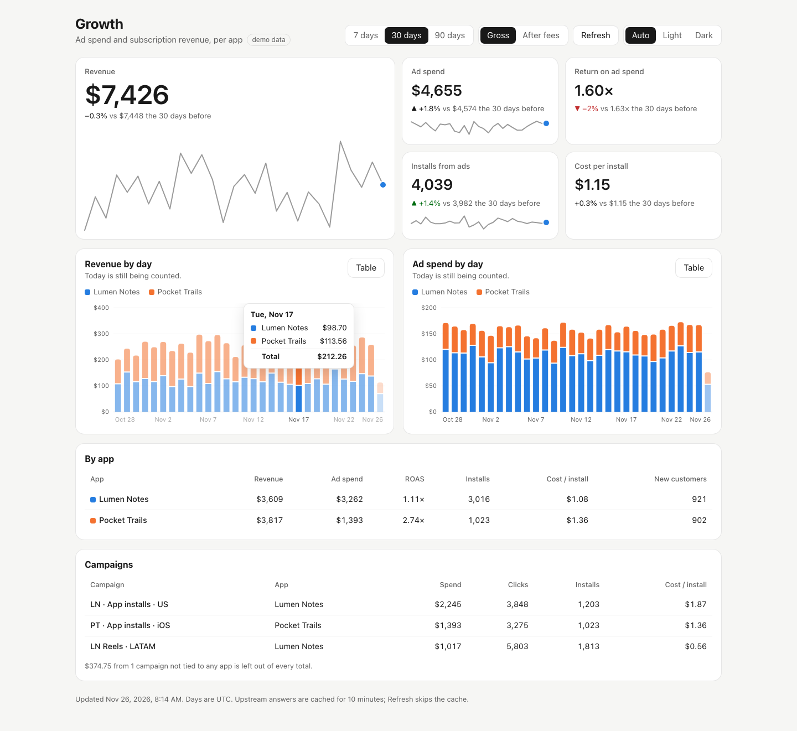
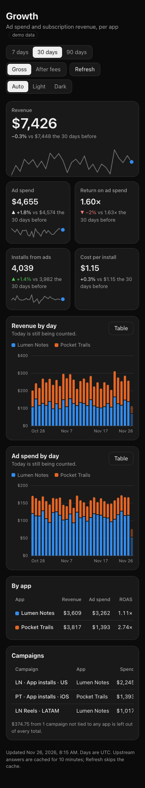

# growth-dashboard

Ad spend next to subscription revenue, per app. A **Laravel 12** API reads RevenueCat (revenue, customers, trials) and
the Meta Marketing API (spend, installs), joins them per app and per day, and compares each figure with the period
before. A **React + TypeScript** dashboard shows the result with hand-built SVG charts.

It runs without any keys: the default `demo` driver serves deterministic sample data.



> This is the growth screen of the admin panel behind my apps ([Wallstudio](https://apps.apple.com/app/id6757434029) and
> [Rein](https://apps.apple.com/app/id6828685068)),
> rebuilt as a standalone app. The original panel is Vue. This version is React, with the same backend logic
> generalised and tested.

```bash
composer setup     # install, .env, key, npm install, build
composer dev       # Laravel on :8000 + Vite with hot reload → http://localhost:8000
```

## What it answers

- How much did ads cost, and what came back? Spend, installs, cost per install, **ROAS**, and gross revenue or revenue
  after store fees (one toggle).
- Is it better or worse than before? Each figure is compared with the previous 7, 30 or 90 days. The change is
  colored by whether that direction is good news (cost per install going up is bad; spend going up is neither), and
  it is also stated in words, so it never relies on color alone.
- Which app, which campaign? Stacked daily columns per app, a per-app table, and campaigns with their cost per install.

## Backend (Laravel)

```
app/Growth/
  Contracts/RevenueSource, AdSource     the two upstreams, behind interfaces
  Sources/RevenueCat/RevenueCatSource   API v2 charts: measure by name, cohorts in s or ms, segments skipped
  Sources/Meta/MetaAdsSource            account + campaigns + daily insights, joined; capped pagination
  Sources/Demo/*                        deterministic sample data (same date → same number, on any machine)
  Caching/Cached*Source                 decorators: 10-minute cache, Refresh bypasses it, failures never cached
  Fx/ExchangeRates                      ad-account currency → reporting currency, with a last-known-good fallback
  CampaignAttributor                    which app a campaign is for
  GrowthReport                          the join, the comparison and the failure isolation
  Period                                last N days in UTC, and the N before
app/Http/Controllers/GrowthController   GET /api/growth?days=7|30|90&refresh=1
```

**One broken key never blanks the dashboard.** Each app's revenue and the ad account are fetched separately. A
failure (revoked key, rate limit, Meta down) becomes an `error` in that block, with a message written for a person.
The message never includes a URL, a token or a header, and tests check this. Everything else still loads, and
`partial: true` tells the UI the totals are missing something. All metrics of an app are fetched before any is
written, so an app is never half-filled.

**Ratios come from sums.** Cost per install is total spend / total installs, not an average of daily ratios. ROAS
leaves out the spend of an app whose revenue failed to load. Counting spend without its revenue would make ROAS look
worse than it is.

**Attribution by what is promoted, not by name.** A campaign belongs to an app if it promotes that app's Meta
application id or store URL. Only campaigns that promote nothing (traffic, awareness) fall back to a name prefix,
because names drift and get copied. Spend that matches no app stays out of every total and is shown apart.

**Upstream limits are respected.** RevenueCat allows 25 requests a minute per key. Every answer is cached for 10
minutes, and Refresh is rate limited to 4 a minute per IP (`throttle:growth`), while plain loads allow 60.

**Currency.** Meta reports in the ad account's currency. Spend is converted with a daily rate that is cached for 12
hours, and the last good rate is kept forever. If the rates service goes down, the dashboard keeps working on
yesterday's rate, and the footnote says so.

## Frontend (React + TypeScript)

```
resources/js/
  App.tsx                     layout, period and gross/net state (remembered), loading / error / partial states
  hooks/useGrowth.ts          TanStack Query: one cache entry per period, previous data kept while switching,
                              Refresh writes the fresh answer into the same entry
  hooks/usePersistentState.ts localStorage that survives private windows and rejects edited values
  components/StackedColumns   SVG chart: hover, keyboard (← → Home End Esc), tooltip, table view
  components/StatTile         figure + change vs the previous period + sparkline
  lib/api.ts                  the typed JSON contract and the fetch, with readable errors (offline, 429, 5xx)
  lib/ticks.ts, format.ts     clean axis steps (0/50/100/150), currency, compact numbers, signed changes
```

The chart is one component of about 230 lines of SVG, with no chart library:
- Columns are capped at 24 px, with a 4 px rounded data end and a square base. Stacked segments are separated by a
  2 px gap in the surface color, not by strokes.
- Each whole day band is the hover target, so a thin column is easy to hit.
- The first and last axis labels align inward and never get clipped.
- Today is drawn lighter and marked "in progress" in the tooltip, the table and the subtitle. It is also left out
  of the sparklines, so a partial day doesn't look like a drop.
- The series colors are checked for color blindness and contrast in both themes. Dark mode has its own color
  steps, not an inversion.
- It is responsive from 390 px up. The page never scrolls sideways; wide tables scroll inside their own card.



## Tests

```bash
php artisan test     # 44 tests: sources with Http::fake, the report, the API end to end
npm test             # 30 tests: formatting, axes, the chart, the whole app with a mocked API
npm run typecheck
```

Highlights:
- An app with a revoked key next to a healthy one: the error is isolated, and no secret leaks into the JSON.
- Caching, request by request: healthy answers are cached, the failing app is retried, and Refresh refetches everything.
- RevenueCat cohorts in seconds and in milliseconds, segmented rows, and a renamed measure.
- Meta pagination that never ends, capped at 20 pages.
- The exchange rate service going down after a good answer.
- The chart driven by mouse and keyboard; the table view with the same numbers.
- The app: switching periods (and remembering the choice), a 429 on Refresh that keeps the cached numbers on
  screen, and the server unreachable followed by Try again.

CI runs Pint, PHPUnit on PHP 8.2–8.4, the type check, Vitest and the production build.

## Going live

Set `GROWTH_DRIVER=live` and fill in `.env` (see `.env.example`). The variables are a RevenueCat v2 secret key per
app (permission `charts_metrics:charts:read`) and a Meta system-user token with `ads_read` only. To add an app, add
an entry in `config/growth.php` with its RevenueCat project and the store ids or name prefix of its campaigns.

The dashboard has no login of its own. Put it behind your auth (in my panel it sits behind Firebase Auth with an
admin allow-list) or a VPN.

MIT licensed.
